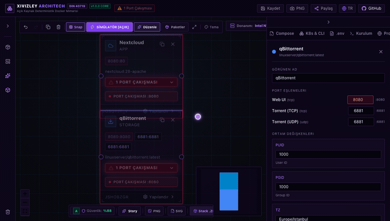
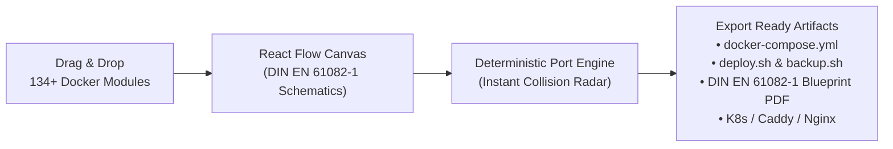

# XIVIZLEY Architech 📐⚡

<p align="center">
  
</p>

> **Industrial DIN EN 61082-1 Visual Docker Compose Architect & Deterministic Port Conflict Resolution Engine.**  
> 100% Client-Side · Zero External Tracking · Offline Ready · 134+ Modules · 33 Curated Stacks

[](https://opensource.org/licenses/MIT)
[](docker-compose.yml)
[](https://nextjs.org)
[](https://reactflow.dev)
[](https://github.com/Xivizley/xivizley-architect/releases)
[](/benchmark)

---

## 🎬 Live Demo (Instant Port Conflict Resolution)

<p align="center">
  
</p>

### 🗺️ Full Canvas & Stack Tour
<p align="center">
  
</p>

---

## 🚀 Overview

**XIVIZLEY Architech** is a standalone, client-side visual architecture tool for orchestrating self-hosted Docker environments. It transforms complex `docker-compose.yml` configurations into an interactive schematic canvas following industrial DIN EN 61082-1 design guidelines.

Equipped with a **deterministic port conflict engine**, Architech instantly detects collisions across host ports, resolves container dependency chains, and generates hardened deployment scripts with zero external server dependencies.

The **universal reverse engineering engine** imports existing infrastructure from three input formats — a `docker-compose.yml`, chained `docker run` commands, or a bash install script with embedded YAML heredocs — and reconstructs them as editable canvas schematics, including implicit dependencies inferred from environment variables such as `REDIS_HOST` or `DB_HOST`.



---

## 🆕 What's New in v1.3.0

This release is a focused stability pass on the canvas, the spec sheet, and the
generated artefacts. No feature was removed and no schematic format changed.

| Area | Fix |
| :--- | :--- |
| Canvas dock | The bottom module dock no longer clips its right margin on narrow viewports (`inset-x-0 mx-auto w-max` instead of a fixed `-80px` offset). |
| Top toolbar | Wraps via a container query (`@min-[480px]:flex-wrap`) once the canvas container is wide enough, and the hardware estimator keeps a stable right edge (`ml-auto`). |
| Output panel | Tabs are now a 3×3 grid — all nine tabs stay legible in a narrow sidebar instead of scrolling horizontally out of reach. |
| Node cards | Long module labels use a two-line clamp with a `title` tooltip instead of hard truncation; every card now reports RAM through the shared estimator. |
| Hardware parity | `resolveModuleResources()` is the single source of truth for modules without a `resources` block, so the canvas, the node badge and the printed specification sheet always agree. |
| `image: :` bug | Platform modules without an image (Docker Engine = host runtime) are no longer emitted as services in `docker-compose.yml`. |
| Backup security | `backup.sh` resolves its passphrase from `XIVIZLEY_BACKUP_PASS`, then `backup.pass`, then an interactive prompt, and passes it to `openssl` via `env:` so it never appears in `ps`. The Backup & DR panel masks the passphrase with a reveal toggle. |
| Legacy canvases | Edges saved before the Obsidian Violet migration (legacy `#06b6d4` stroke) render with the current violet gradient instead of a stray cyan wire. |
| i18n | `common.close` was missing from every locale, so close buttons on the inspector and the output panel had no accessible name. |
| Spec naming | Blueprint wording, PDF filename and metadata now reference **DIN EN 61082-1** (the current standard) instead of DIN 40719. |

---

## ✨ Key Capabilities

- **⚡ 134+ Curated Docker Modules**: From Nextcloud, Jellyfin, and Vaultwarden to PostgreSQL, Redis, and FiveM, each module includes pre-configured environment templates, volumes, and default ports.
- **🛡️ Deterministic Conflict Detection**: Automatically detects host port overlaps across TCP/UDP sockets and offers one-click conflict resolution with safe alternate port suggestions.
- **📑 DIN EN 61082-1 Technical Blueprint**: Generates an authentic industrial blueprint specification sheet ready for printing or high-resolution PDF documentation.
- **📦 33 Curated Industrial Stacks**: Instant 1-click loading of popular homelab, media, devops, privacy, and gaming architectures.
- **🔄 Universal Reverse Engineering**: Import an existing `docker-compose.yml`, chained `docker run` commands, or a bash installer heredoc and get an editable schematic with implicit dependency edges.
- **💾 Full Disaster Recovery Automation**: Generates automated `backup.sh` and `restore.sh` scripts with volume compression and database snapshots.
- **🔒 Zero-Leak Privacy Guarantee**: Runs entirely in your browser using client-side Zustand state. No external tracking, no external API calls, and no client-side telemetry.

---

## 📊 Verified Benchmarks & Press Kit

The release ships two static, server-rendered documentation surfaces — no tracking, no cookies, no API routes:

| Surface | Turkish | English |
| :--- | :--- | :--- |
| Hardware benchmark specification | [`/benchmark`](/benchmark) | [`/en/benchmark`](/en/benchmark) |
| Press & media kit | [`/press`](/press) | [`/en/press`](/en/press) |
| English overview | — | [`/en`](/en) |

Measurements were taken directly on the independently rented Bursa PenDC Tier-3 test host (**AS42868**, Ubuntu 24.04 LTS, Linux 6.8) on 16 October 2026:

| Metric | Result |
| :--- | :--- |
| sysbench CPU (4 threads) | **1,881.52 events/sec**, 2.12 ms average latency |
| fio 4K random read | **6,649 IOPS** (27.2 MB/s) |
| fio 4K random write | **6,664 IOPS** (27.3 MB/s) |
| Combined 4K throughput | **13,313 IOPS** |
| fio sequential read / write | **584.41 / 772.91 MB/s** |
| Network latency | **1.871 ms** average |

Raw `fio` and `sysbench` console output, the exact reproduction commands, and the test methodology are published on the benchmark pages. The test host IP is intentionally withheld: it is only rendered when `NEXT_PUBLIC_VDS_IP` is explicitly set. No sponsorship or endorsement relationship is implied by the hosting provider.

---

## 🏁 Quickstart

### Option A: Run via Docker (Recommended)

```bash
# Clone repository
git clone https://github.com/Xivizley/xivizley-architect.git
cd xivizley-architect

# Launch container
docker compose up -d

# Open http://localhost:3000 in your browser
```

### Option B: Run via Node / pnpm

```bash
# Install dependencies
pnpm install

# Start development server
pnpm dev
```

Visit [http://localhost:3000](http://localhost:3000) to open the interactive canvas.

---

## 🛠️ Supported Module Categories

| Category | Modules Included |
| :--- | :--- |
| **Databases** | PostgreSQL, MariaDB, MySQL, MongoDB, Redis, InfluxDB, ClickHouse, Meilisearch |
| **Media & Homelab** | Jellyfin, Plex, Sonarr, Radarr, Prowlarr, Bazarr, Lidarr, Tautulli, MeTube, Audiobookshelf |
| **DevOps & CI/CD** | Dockge, Portainer, Forgejo, Gitea, GitLab, Drone, Uptime Kuma, Beszel |
| **Security & Privacy** | Vaultwarden, Authentik, Authelia, CrowdSec, WireGuard, Tailscale, RustDesk, SearXNG |
| **Storage & Cloud** | Nextcloud, Seafile, Filebrowser, Syncthing, MinIO, PairDrop |
| **Productivity** | Docmost, Actual Budget, Firefly III, Karakeep, Stirling-PDF, Paperless-ngx, Trilium |

---

## 📜 Keyboard Shortcuts

- `Ctrl + K` / `Cmd + K`: Open Command Palette
- `Ctrl + Z` / `Cmd + Z`: Undo canvas action
- `Ctrl + Shift + Z` / `Cmd + Y`: Redo canvas action
- `Delete` / `Backspace`: Remove selected node
- `Space + Drag`: Pan canvas view

---

## ⚖️ License

Distributed under the **MIT License**. Created by [Alperen Celal Hoşça](https://github.com/alperencelal).
See [LICENSE](LICENSE) for full details.
