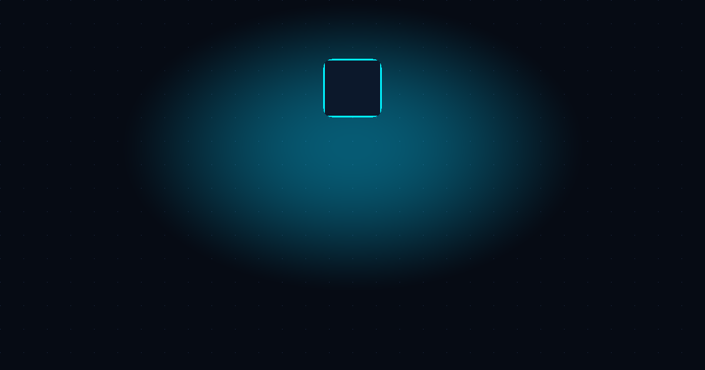
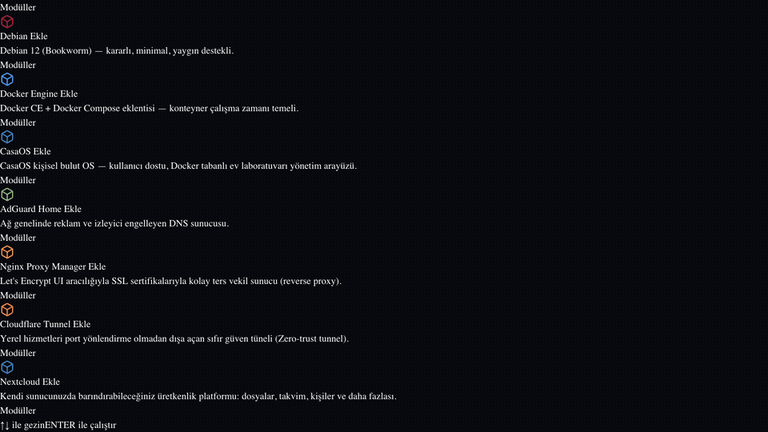
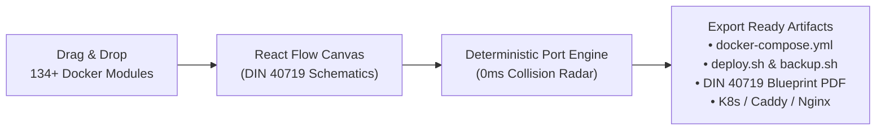

# XIVIZLEY Architech 📐⚡

<p align="center">
  
</p>

> **Industrial DIN 40719 Visual Docker Compose Architect & Deterministic Port Conflict Resolution Engine.**  
> 100% Client-Side · Zero Telemetry · Offline Ready · 134+ Modules · 33 Curated Stacks

[](https://opensource.org/licenses/MIT)
[](docker-compose.yml)
[](https://nextjs.org)
[](https://reactflow.dev)

---

## 🎬 Live Demo

<p align="center">
  
</p>

---

## 🚀 Overview

**XIVIZLEY Architech** is a standalone, client-side visual architecture tool for orchestrating self-hosted Docker environments. It transforms complex `docker-compose.yml` configurations into an interactive schematic canvas following industrial DIN 40719 design guidelines.

Equipped with a **deterministic port conflict engine**, Architech instantly detects collisions across host ports, resolves container dependency chains, and generates hardened deployment scripts with zero external server dependencies.



---

## ✨ Key Capabilities

- **⚡ 134+ Curated Docker Modules**: From Nextcloud, Jellyfin, and Vaultwarden to PostgreSQL, Redis, and FiveM, each module includes pre-configured environment templates, volumes, and default ports.
- **🛡️ Deterministic Conflict Detection**: Automatically detects host port overlaps across TCP/UDP sockets and offers one-click conflict resolution with safe alternate port suggestions.
- **📑 DIN 40719 Technical Blueprint**: Generates an authentic industrial blueprint specification sheet ready for printing or high-resolution PDF documentation.
- **📦 33 Curated Industrial Stacks**: Instant 1-click loading of popular homelab, media, devops, privacy, and gaming architectures.
- **💾 Full Disaster Recovery Automation**: Generates automated `backup.sh` and `restore.sh` scripts with volume compression and database snapshots.
- **🔒 Zero-Leak Privacy Guarantee**: Runs entirely in your browser using client-side Zustand state. No tracking, no external API calls, and zero telemetry.

---

## 🏁 Quickstart

### Option A: Run via Docker (Recommended)

```bash
# Clone repository
git clone https://github.com/Xivizley/xivizley-architech.git
cd xivizley-architech

# Launch container
docker compose up -d

# Open http://localhost:3000 in your browser
```

### Option B: Run via Node / pnpm

```bash
# Install dependencies
pnpm install

# Start development server
pnpm dev
```

Visit [http://localhost:3000](http://localhost:3000) to open the interactive canvas.

---

## 🛠️ Supported Module Categories

| Category | Modules Included |
| :--- | :--- |
| **Databases** | PostgreSQL, MariaDB, MySQL, MongoDB, Redis, InfluxDB, ClickHouse, Meilisearch |
| **Media & Homelab** | Jellyfin, Plex, Sonarr, Radarr, Prowlarr, Bazarr, Lidarr, Tautulli, MeTube, Audiobookshelf |
| **DevOps & CI/CD** | Dockge, Portainer, Forgejo, Gitea, GitLab, Drone, Uptime Kuma, Beszel |
| **Security & Privacy** | Vaultwarden, Authentik, Authelia, CrowdSec, WireGuard, Tailscale, RustDesk, SearXNG |
| **Storage & Cloud** | Nextcloud, Seafile, Filebrowser, Syncthing, MinIO, PairDrop |
| **Productivity** | Docmost, Actual Budget, Firefly III, Karakeep, Stirling-PDF, Paperless-ngx, Trilium |

---

## 📜 Keyboard Shortcuts

- `Ctrl + K` / `Cmd + K`: Open Command Palette
- `Ctrl + Z` / `Cmd + Z`: Undo canvas action
- `Ctrl + Shift + Z` / `Cmd + Y`: Redo canvas action
- `Delete` / `Backspace`: Remove selected node
- `Space + Drag`: Pan canvas view

---

## ⚖️ License

Distributed under the **MIT License**. Created by [Alperen Celal Hoşça](https://github.com/alperencelal).
See [LICENSE](LICENSE) for full details.
